<p align="center">
  
</p>

<h1 align="center">Shoal</h1>

<p align="center">
  <b>浅海生态模拟工作台</b><br>
  在地图上选取海域，模拟一维水柱或陆架尺度的水温、营养盐、浮游生物、底栖动物与鱼类动态。
</p>

<p align="center">
  
  
  
  
</p>

<p align="center">
  <a href="#下载安装">下载安装</a> ·
  <a href="#五分钟上手">五分钟上手</a> ·
  <a href="#功能导览">功能导览</a> ·
  <a href="#模型与方法">模型与方法</a> ·
  <a href="#从源码运行">从源码运行</a>
</p>

<p align="center">
  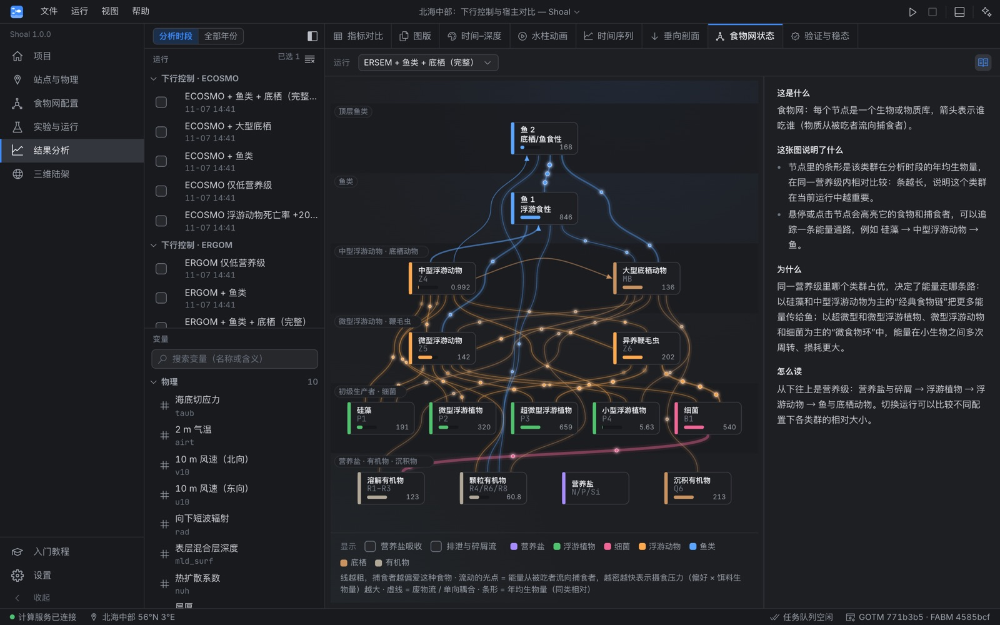
</p>

> *shoal* 在英语里兼具“浅海、浅滩”与“鱼群”两层意思，对应本软件模拟的海域与生物群落。

## 为什么做 Shoal

探讨“鱼类捕食掉多少浮游生物、其排泄与呼吸反过来又如何影响水体”这类问题，需要把物理海洋、生物地球化学和高营养级渔业模型耦合起来，即**端到端（end-to-end）生态模型**。传统工作流往往需要自行编译 Fortran 源码、手动维护大量配置文件并编写绘图脚本，上手门槛较高。

Shoal 将建模、运行与结果分析整合在同一个桌面工作台中：

- **图形化配置与运行**：选择海域与研究问题即可自动生成模型配置和对照实验，直接启动模拟。
- **支持全球陆架海域**：根据经纬度自动获取 ERA5 气象强迫、WOA23 气候态剖面和 ETOPO 水深，构建一维水柱站点。
- **图表自动标注与解读**：图上直接标出春华、温跃层、极值时刻与深度，并附有基于当前输出计算的读图说明。
- **内置配套教程**：全中文界面，专业术语悬停可查；配有 15 章入门教程与交互式小实验。
- **单点水柱与陆架网格兼顾**：同一套生态配置既可在单点水柱上做精细实验，也可扩展到陆架网格查看空间分布。

## 能回答什么问题

| 研究问题 | 自动生成的对照实验 |
| --- | --- |
| 鱼类和底栖动物对浮游生物有多大影响？ | 仅低营养级 / 加大型底栖 / 加鱼类 / 完整耦合 / 仅将浮游动物死亡率提高 20% |
| 结论是否依赖所选的低营养级模型？ | 同一套高营养级模块分别接入 ERSEM、ECOSMO、ERGOM |
| 鱼类反馈会改变浮游生物和鱼类自身吗？ | 无鱼基线 / 单向耦合（鱼类不消耗饵料）/ 双向耦合 |
| 用功能群还是粒径谱表示鱼类，结果有何差异？ | 在同一水柱上分别接入 E2E 功能群与 MIZER 粒径谱 |
| 模型对某个参数有多敏感？ | 参数扫描：指定参数与取值范围，自动生成一组对比运行 |

## 五分钟上手

1. **新建项目**：在世界地图上点选站点（或从预设海域中选择），勾选要探讨的研究问题。
2. **准备站点数据**：后台自动下载该位置的气象强迫、气候态剖面和水深，约需 1–3 分钟；无网络时可使用内置离线算例。
3. **运行实验**：在“实验与运行”页点击“全部运行”，多进程并行计算；单次 5 年模拟在普通笔记本上约需 20 秒。计算完成后点击通知中的“对比结果”即可查看输出。
4. **查看结果**：列表中第一个勾选的运行作为基准，其余运行与之对比；可在“结果分析”页查看汇总指标、时间–深度剖面、季节循环及多面板图版。
5. **扩展到陆架区域**（可选）：在“三维陆架”页框选海域并设置网格分辨率，在每个海洋格点上批量运行水柱集合。

内置教程第 0 章《认识 Shoal》包含软件各页面的操作说明与完整示例，第 1 章《安装与设置》介绍安装、数据目录及 AI 助手配置。

<p align="center">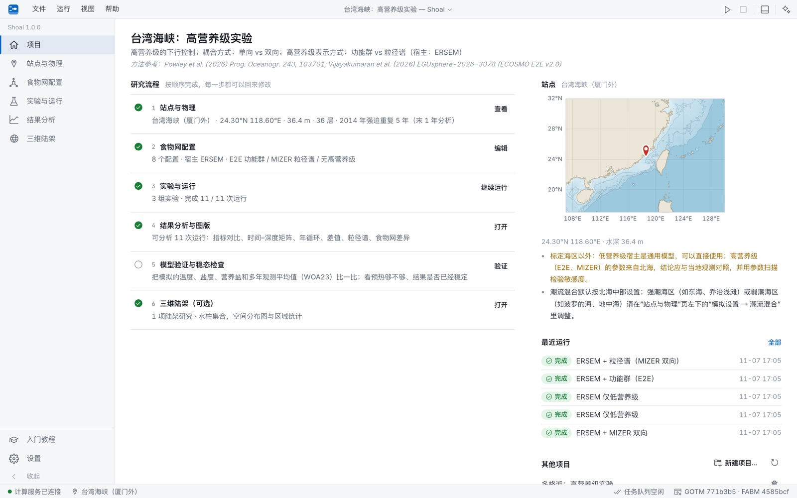</p>

## 功能导览

### 食物网与能量流

连线上的光点从饵料流向捕食者。光点越密集、移动越快，代表该路径上的摄食压力（偏好系数 × 饵料生物量）越大。节点内的横向条表示各类群的年均生物量；将鼠标悬停在某个节点上，可单独查看与之相连的摄食与排泄路径。

<p align="center">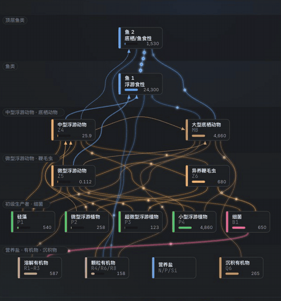</p>

### 单点水柱的逐日演变

水柱剖面动画按天展示全年的垂向结构演变。左侧为深度标尺，右侧用引线实时标出当天的**混合层底界**、**温跃层深度**以及**浮游植物峰值深度**，并附有简要说明。

<p align="center">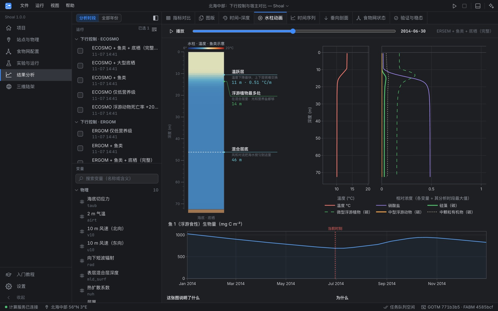</p>

### 季节循环与垂向剖面

年循环曲线上自动标出春华、次高峰、全年极值、营养盐耗尽等关键节点（南半球站点会自动按当地季节标注）。时间–深度剖面图同时标出极值位置与平滑后的混合层深度。

<table>
  <tr>
    <td>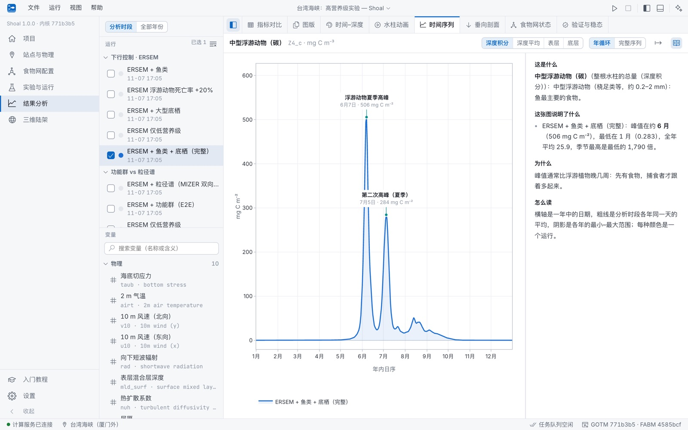</td>
    <td>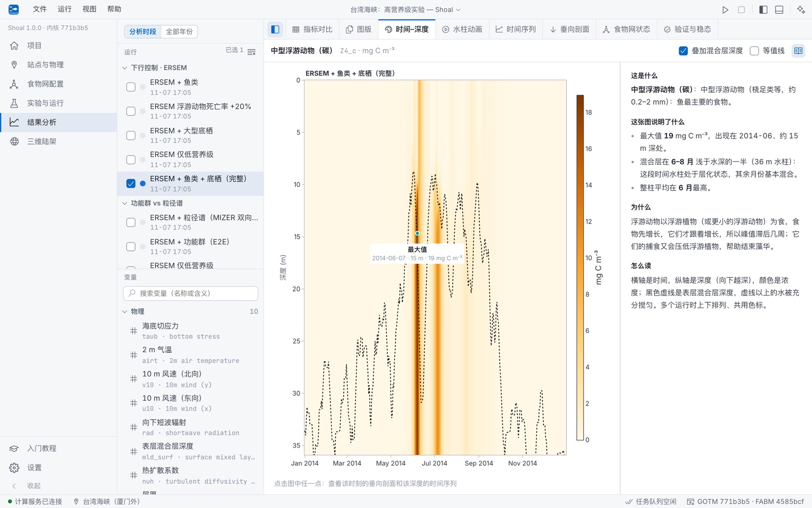</td>
  </tr>
</table>

### 站点气象与气候态剖面

ERA5 逐日气象数据以细线展示，叠加 30 天滑动平均粗线，并标出最高温、最低温、最大风速和最强短波辐射日期。WOA23 月气候态剖面图同时标出各月的温跃层或营养跃层深度。

<table>
  <tr>
    <td>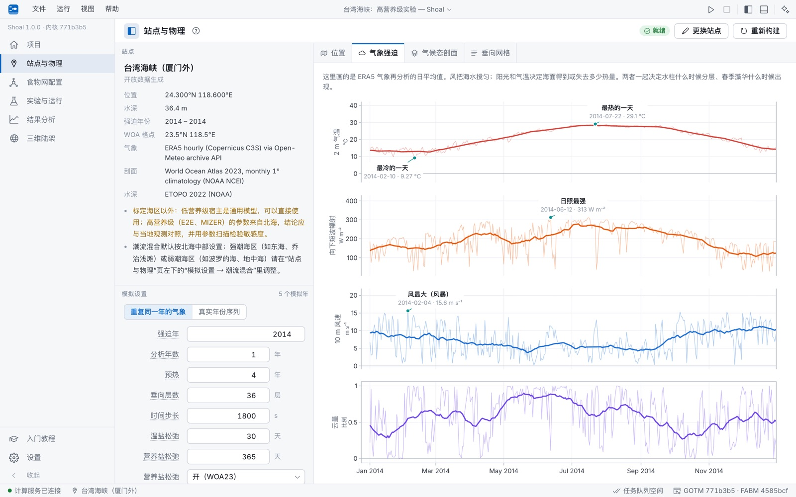</td>
    <td>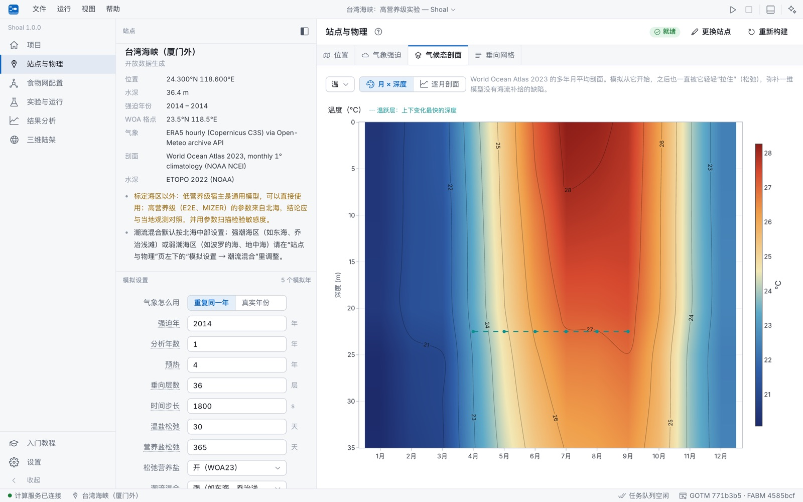</td>
  </tr>
</table>

### 陆架尺度的水柱集合

陆架研究将同一套生态配置应用到研究海域的各个网格点（每个格点作为独立的一维水柱运行）。“逐月走势”将所有水柱的月均曲线按水深分区着色，并在右侧汇入各分区的全年平均值；三维视图则将各水柱的指标叠加在真实海底地形上。

<table>
  <tr>
    <td>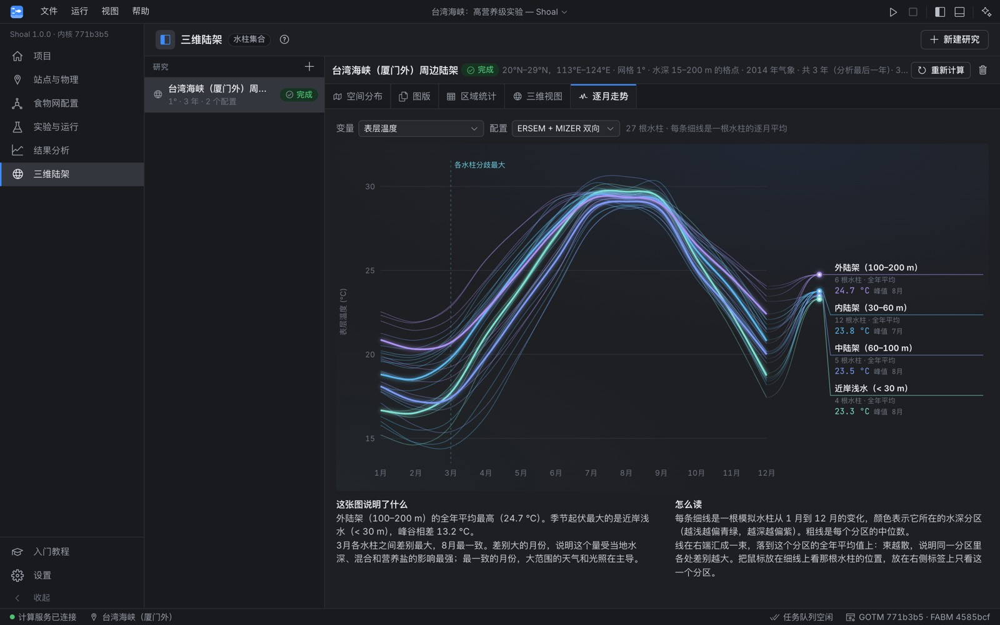</td>
    <td>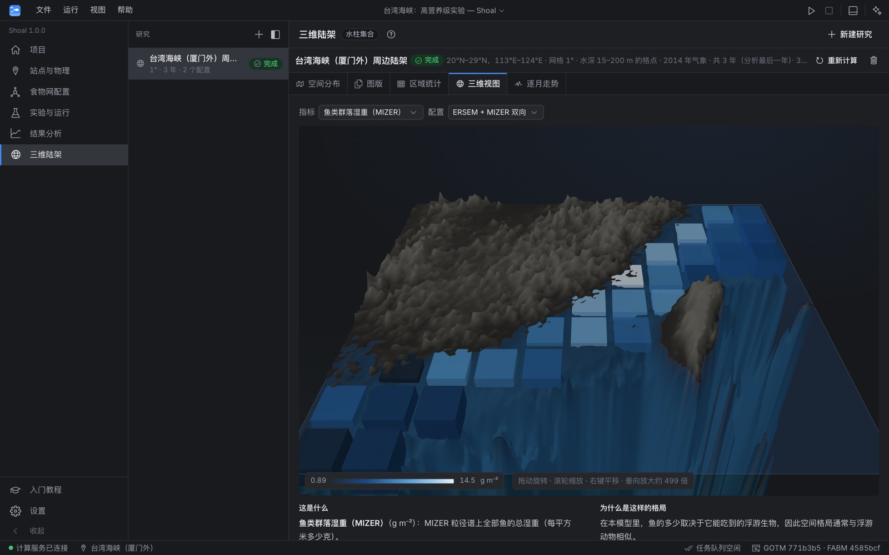</td>
  </tr>
</table>

### 多面板图版与数据导出

内置多种科研常用图版：变量 × 运行的时间–深度矩阵、高营养级季节循环、相对基准的变化柱状图、多年演变曲线、碳库与通量差值图以及参数扫描响应曲线；陆架研究提供双配置对比与差值图、多指标百分比变化图。所有图表均支持框选缩放、双击还原及导出 3 倍分辨率 PNG；统计指标表与时间序列可导出为 CSV，完整模拟输出保存为标准 NetCDF 文件。

<table>
  <tr>
    <td>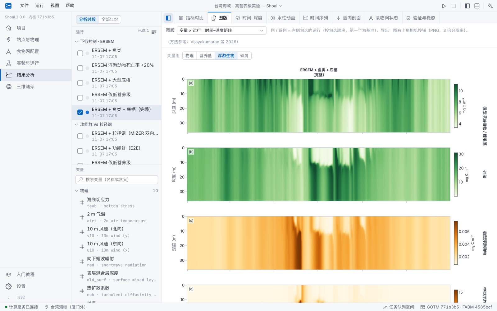</td>
    <td>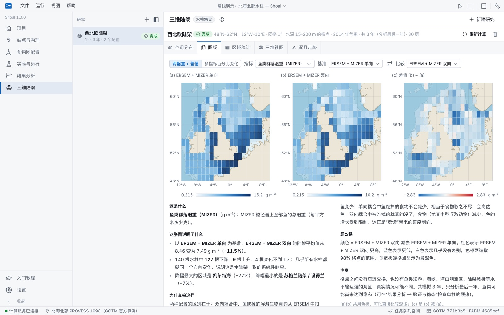</td>
  </tr>
</table>

### 稳态检查与气候态对比

“验证与稳态”标签页用于检查模拟预热是否充分（在对数坐标下展示各变量的逐年漂移率），并将模拟结果与 WOA23 气候态剖面进行对比，计算偏差、均方根误差（RMSE）、相关系数及泰勒图（Taylor diagram）。

<p align="center">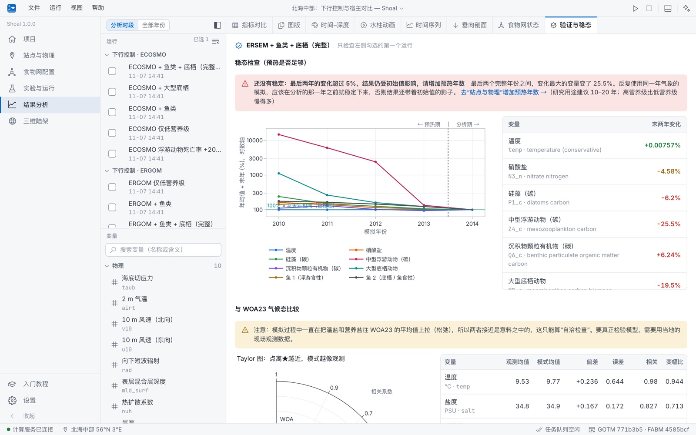</p>

### 教程与辅助工具

内置 15 章入门教程，从软件操作、水柱物理、FABM 耦合框架到高营养级建模与经典文献复现，逐步展开，并配有 8 个可交互的简化模型实验。可选配 AI 助手（支持 OpenAI 兼容接口及本地运行的 Ollama 模型），用于检索教程、对比运行结果或生成配置修改提案（所有修改均需用户确认后才会写入）。

<p align="center">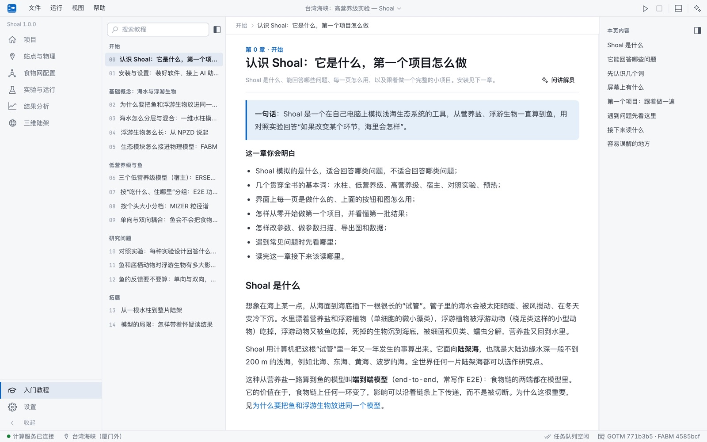</p>

## 下载安装

从 [Releases](https://github.com/lycself/Shoal/releases/latest) 下载对应系统的安装包，无需额外部署 Python 或编译环境：

| 系统 | 安装包 |
| --- | --- |
| macOS（Apple 芯片 / Intel） | `Shoal-<版本>-macos-arm64.dmg` / `…-macos-x64.dmg`：打开后将 Shoal 拖入“应用程序” |
| Windows 10 / 11 | `Shoal-<版本>-windows-x64-setup.exe`：双击安装，无需管理员权限 |
| Linux（Ubuntu 22.04 及以上） | `Shoal-<版本>-linux-x64.tar.gz`：解压后运行 `Shoal/Shoal`，执行 `./install-desktop-entry.sh` 可添加桌面图标 |

由于安装包未购买商业代码签名，首次打开时系统可能会弹出安全提示：macOS 请在“系统设置 → 隐私与安全性”中点击“仍要打开”（或在终端执行 `xattr -dr com.apple.quarantine /Applications/Shoal.app`）；Windows 请点击“更多信息 → 仍要运行”。

**启动与退出**：双击 Shoal 后，计算服务会在后台启动并自动打开浏览器界面，同时在系统托盘（macOS 为顶部菜单栏）显示图标。直接关闭浏览器标签页不会中断正在运行的模拟；点击托盘图标中的“打开 Shoal”可重新打开界面，选择“退出 Shoal”则会彻底关闭后台服务。

**版本更新**：软件会定期检查更新，发现新版本时在顶部给出提示，可在“设置 → 软件版本与更新”中下载并重启更新。所有项目与缓存数据均保存在用户数据目录下（macOS 为 `~/Library/Application Support/Shoal`，Windows 为 `%LOCALAPPDATA%\Shoal`，Linux 为 `~/.local/share/shoal`），更新或重装软件不会影响已有数据。

更多关于安装排错、数据备份、离线使用及 AI 助手配置的说明，请参阅内置教程《安装与设置》一章。

## 模型与方法

| 模块 | 实现方案 |
| --- | --- |
| 一维水柱物理 | [GOTM](https://gotm.net) 一维水柱湍流模型（k-ε 湍流闭合），潮流混合采用周期性海面坡度近似 |
| 耦合框架 | [FABM](https://fabm.net)（Framework for Aquatic Biogeochemical Models） |
| 低营养级宿主 | [ERSEM](https://github.com/pmlmodelling/ersem)、ECOSMO、ERGOM（涵盖营养盐、浮游植物、浮游动物、细菌、碎屑与沉积物） |
| 高营养级：功能群 | ECOSMO E2E v2.0：浮游食性鱼类、底栖/鱼食性鱼类与大型底栖动物（默认使用官方源码，可选物质守恒修正版） |
| 高营养级：粒径谱 | [FABM-MIZER](https://github.com/BoldingBruggeman/fabm-mizer)：按个体体重划分的鱼类群落粒径谱，支持单向与双向耦合 |
| 外部数据 | ERA5 逐小时气象再分析（经 Open-Meteo）、World Ocean Atlas 2023 月气候态、ETOPO 2022 地形水深 |

核心参考研究：

- Powley et al. (2026), *Progress in Oceanography* 243, 103701：西北欧陆架 ERSEM 与 FABM-MIZER 鱼类粒径谱的单向与双向耦合研究。
- Vijayakumaran et al. (2026), *EGUsphere* egusphere-2026-3078：北海中部 ECOSMO E2E v2.0 高营养级功能群与三个低营养级宿主的耦合对比。

两篇文献均为 CC BY 4.0 开放获取，PDF 原文附于仓库 `reference/` 目录。

## 适用范围与已知局限

- 低营养级宿主模型本身具有通用性，但高营养级模块（E2E、MIZER）的默认参数标定自北海。用于其他海域时，建议结合当地观测资料调整参数，并利用参数扫描评估敏感度。
- 一维水柱模型不包含真实三维潮波，默认潮流混合强度对应北海中部，应用于强潮或弱潮海区时请在“站点与物理”页面调整潮流系数。
- 三维陆架模式采用独立水柱集合（每个网格点单独运行一维 GOTM 水柱），未包含水平平流输运与鱼类跨格点迁徙。完整三维水动力–生态耦合（如 NEMO-AMM7）需在高性能计算集群上运行。
- 模拟过程中温度、盐度与营养盐向 WOA23 气候态松弛，因此“验证与稳态”中与 WOA23 的对比仅作为自洽性检查；严格的模型验证需依赖独立的现场观测数据。
- 软件主要面向水深 200 m 以内的陆架浅海；虽然也能在深海大洋格点运行，但忽略水平环流带来的偏差会更为显著。

<a id="从源码运行"></a>
<details>
<summary><b>从源码运行（开发者）</b></summary>

支持 macOS、Linux（Ubuntu 等）和原生 Windows。需要：Python 3.11、Node.js + pnpm，以及编译内核用的 gfortran、NetCDF-Fortran、CMake、Git。

**1. 建 Python 环境**：在仓库根目录用 Python 3.11 运行

```bash
python -m venv .venv
```

然后安装后端依赖（macOS / Linux）：

```bash
.venv/bin/python -m pip install -r backend/requirements.txt
```

Windows：

```bat
.venv\Scripts\python -m pip install -r backend\requirements.txt
```

国内可加 `-i https://pypi.tuna.tsinghua.edu.cn/simple` 换镜像。

**2. 装编译工具**（只需一次）：

| 系统 | 命令 |
| --- | --- |
| macOS | `brew install gcc netcdf-fortran cmake git`（gcc 里带 gfortran） |
| Ubuntu / Debian | `sudo apt install gfortran libnetcdff-dev cmake git` |
| Windows | 装 [MSYS2](https://www.msys2.org/)，在 “MSYS2 UCRT64” 终端运行 `pacman -S --needed mingw-w64-ucrt-x86_64-gcc-fortran mingw-w64-ucrt-x86_64-netcdf-fortran mingw-w64-ucrt-x86_64-cmake mingw-w64-ucrt-x86_64-make git`，再把 `C:\msys64\ucrt64\bin` 加进 PATH |

**3. 检查环境、编译内核、启动**：

```bash
pnpm install
pnpm check:env      # 检查 .venv、Python 版本、依赖和编译工具，缺什么就给出本系统的安装命令
pnpm kernel         # 编译 GOTM + pyfabm（含 ERSEM、MIZER、E2E），首次约 5–10 分钟
pnpm dev            # 同时启动后端 :8765 和前端 :5173
```

浏览器打开 <http://localhost:5173>。首次启动会自动创建一个离线演示项目（GOTM 官方北海北部算例，不需要联网）。可用的环境变量：

| 变量 | 作用 |
| --- | --- |
| `SHOAL_PYTHON` | `pnpm kernel` 和 `pnpm dev` 用哪个 Python（默认是仓库根目录的 `.venv`） |
| `SHOAL_WORKSPACE` | 把项目、数据缓存和设置放到别的文件夹（默认是仓库里的 `workspace/`） |
| `SHOAL_KERNEL` | 使用别处编译好的内核（文件夹里要有 `bin/gotm` 和 `kernel.json`） |
| `SHOAL_API_PORT` | 计算服务的端口（默认 8765） |

</details>

<details>
<summary><b>目录结构</b></summary>

```
backend/shoal/        FastAPI 后端
  server.py               HTTP / WebSocket 接口
  projects.py             项目、配置、实验、运行的存储与实验设计模板
  runner.py               后台任务（站点构建、GOTM 运行）与进度
  runs.py                 生成运行目录（gotm.yaml + fabm.yaml），选择输出变量
  results.py              读取 NetCDF：时间–深度、年循环、剖面、对比、粒径谱
  sites/builder.py        站点：开放数据 → GOTM 强迫文件
  data/sources.py         ERA5 / WOA23 / ETOPO 下载与缓存
  ecosystem/              宿主定义、fabm.yaml 生成、食物网图
  threed/                 陆架水柱集合与算力评估
  assistant/agent.py      AI 助手（工具调用）
  desktop/                安装版启动器（托盘、单实例、浏览器）与自动更新
frontend/src/             React 前端（pages/、components/；primer/content/ 是入门教程的 Markdown 章节，primer/labs.tsx 是交互实验）
kernel/                   计算内核
  build.py                获取源码并编译 GOTM 与 pyfabm（pnpm kernel）
  e2e/                    按论文方程重写的 E2E 鱼类与大型底栖模块（对照用）
  vendor/ecosmo-e2e/      官方 ECOSMO E2E v2.0 源码与算例（CC BY 4.0，未改动）
  patches/                官方代码的物质收支修正补丁（默认关闭）
packaging/                PyInstaller 配置、Windows 安装器、图标、update.json 生成
docs/images/              本 README 的截图
.github/workflows/        CI（三个平台编译内核并测试）与发布
```

</details>

<details>
<summary><b>打包与发布</b></summary>

本地打当前系统的安装包（需要先 `pnpm kernel` 和 `pnpm build`）：

```bash
.venv/bin/python -m pip install -r packaging/requirements.txt
node scripts/venv.mjs packaging/build_app.py      # → dist/release/
```

发布新版本：把 `backend/shoal/version.py` 改成新版本号并提交，然后推送带说明的标签。GitHub Actions 会在 macOS（Apple 芯片、Intel）、Windows、Linux 上编译、测试、打包，并创建 Release 和 `update.json`，已安装的 Shoal 随后就会提示更新。标签说明就是软件里显示的“更新内容”。

```bash
git tag -a v1.0.1 -m "这一版的更新内容"
git push origin v1.0.1
```

每次推送都会跑 CI；在 Actions 页面手动运行 CI 可以只打安装包、不发布。

</details>

<details>
<summary><b>ECOSMO E2E 官方代码与修正</b></summary>

鱼类与大型底栖功能群默认用 ECOSMO E2E v2.0 的官方 Fortran 代码（Zenodo doi:10.5281/zenodo.20413770，CC BY 4.0），源码和算例未作改动，放在 `kernel/vendor/ecosmo-e2e/`（来源、许可证和校验和见其中的 `NOTICE.md`）。

1. `pnpm kernel` 把官方代码（FABM 模型名 `ecosmoe2e_fish`、`ecosmoe2e_mb`）和按论文方程重写的版本（`kernel/e2e/`）一起编进内核，安装包里两份都有，在“食物网配置 → 计算代码”里选择。
2. 要重跑验证，需要完整的官方压缩包（`ecosmoe2e_gmd.zip`，含驱动数据和参考结果）：下载后把 `README.md`、`src/`、`testcases/`、`forcing/`、`ibt_survey/` 复制到 `kernel/src/ecosmo-e2e/`。
3. 官方代码里有 5 处物质不守恒或符号错误（鱼的 DOM 部分丢失、鱼呼吸产生氧气、硅按 Redfield 比例被扣掉、呼吸的碳丢失、底栖动物温度项常数）。`kernel/build.py` 在副本上打 `kernel/patches/ecosmo-e2e-corrections.patch`，把修正做成默认关闭的 FABM 参数；“食物网 → 物质收支”选“修正版”（新建配置的默认）时打开，关闭时与原代码逐位相同。说明与验证见 [kernel/patches/README.md](kernel/patches/README.md)。

验证（ERSEM 宿主，北海中部 56°N 3°E，官方驱动与配置，“原样”设置）：第一年与官方参考结果相差 1–4%；官方算例里鱼 2 的两个摄食率写作 0.004，而参考结果用的是 0.0045，改成 0.0045 后高营养级第一年在 1% 以内。官方算例里的 ECOSMO、ERGOM 是未公开的 NECCTON 项目版本，Shoal 用 FABM 自带的 nersc/ecosmo 与 msi/ergom1。详见入门教程的“E2E 功能群”和“模型的局限”两章。

</details>

## 许可证

Shoal 以 [GNU GPL 第 3 版或更高版本](LICENSE)（GPL-3.0-or-later）发布：可以自由使用、修改和转发，转发时须同样以 GPL 提供源码。用 Shoal 算出的结果、图和论文不受许可证约束。安装包里的第三方组件（GOTM、FABM、ERSEM、FABM-MIZER、ECOSMO E2E、NetCDF 及 Python 库等）各有自己的许可证，见 [THIRD_PARTY_NOTICES.md](THIRD_PARTY_NOTICES.md)。
